# Отчёт по практической работе №5

**Тема:** Ведение требований прямо в репозитории.\
**Выполнил:** Малинин Константин Николаевич.\
**Группа:** М-25 ИО.\
**Дата основной работы:** 16.11.2026.\
**Дата завершения оформления:** 17.11.2026.\
**Номер работы:** 5.

## 1. Цель, проект и результат

Цель — связать требования, задачи, изменения кода, тесты и верификацию в одном Git-репозитории. Создан отдельный проект «Менеджер заметок» с русскоязычным CLI и локальным JSON-хранилищем. Работа выполнена индивидуально. Внешнее ревью и проверка удобства независимым новым пользователем не заявляются.

Публичный репозиторий: <https://github.com/konstmalinin-maker/requirements-demo>.

GitHub Project: <https://github.com/users/konstmalinin-maker/projects/2>.

Основная реализация объединена с `main` через [PR #20](https://github.com/konstmalinin-maker/requirements-demo/pull/20). Он автоматически закрыл все 19 Issues. В истории сохранены отдельные Conventional Commits с REQ-ID, а не один общий squash-коммит.

Проверка: **54 теста проходят**, покрыто **197 из 200 исполняемых строк (98,5%)**, обязательный порог — 80%. Полная команда list на 10000 заметок в локальной среде Python 3.12.14/Linux заняла **111,1 мс** при лимите 500 мс. Успешный CI выполнен также на GitHub Actions (Python 3.12.16).

## 2. Структура репозитория и SRS

Репозиторий содержит README, MIT License и Python `.gitignore`. Требования разделены на четыре файла в `docs/requirements`: business, user, functional и non-functional. Общая спецификация находится в `docs/srs.md`, термины — в `docs/glossary.md`, связи — в `docs/traceability.md`, журнал версий — в `docs/requirements/changelog.md`.

Исходники расположены в `src`, тесты — в `tests`, средства трассируемости — в `scripts`, workflows и шаблон Issue — в `.github`. Настройки покрытия и тестов хранятся в `pyproject.toml`, настройки Conventional Commits — в `commitlint.config.js` и `.husky/commit-msg`.

В SRS 19 уникальных требований: BR — 3, UR — 5, FR — 5, NFR — 6. У каждого указаны приоритет, источник или родитель, критерий приёмки, версия и тестовая связь. ID не переиспользуются. Текущее SRS имеет версию 1.1; FR-003 — редакцию @v2, остальные требования — @v1.

Границы проекта: локальный пользователь ОС, без отдельного сервера и регистрации. Конкурирующая запись нескольких процессов не поддерживается. Права 0600 и синхронизация каталога проверяются в POSIX. Учебный критерий удобства BR-002 проверен индивидуальным сценарием и встроенной справкой; это не полноценное исследование новых пользователей.

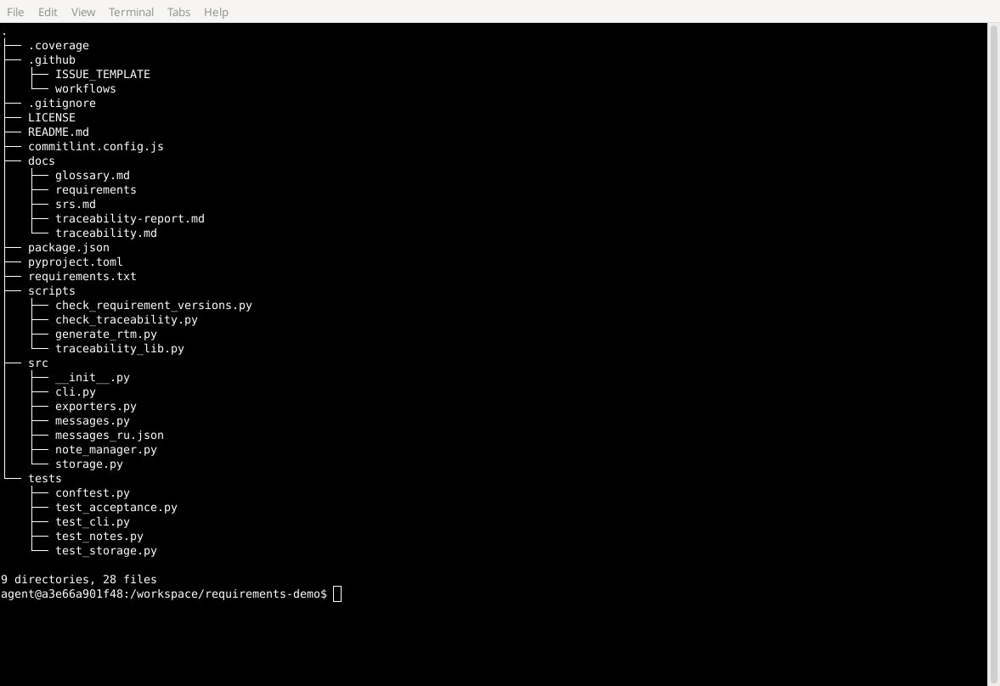

Рисунок 1. Структура реального репозитория в терминале, tree -a -L 2.

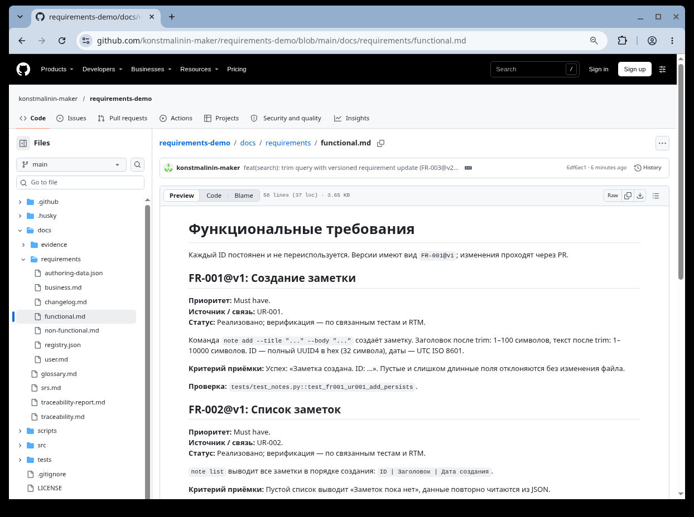

Рисунок 2. SRS в Markdown: FR-001, приоритет, связь с UR-001 и критерий приёмки.

## 3. Требования и связанные Issues

Создано 19 Issues — по одной на каждое требование, что превышает минимум 8. Использован шаблон `.github/ISSUE_TEMPLATE/requirement.md`: описание, критерии, связанные требования и Definition of Done. Базовые метки: `requirement`, тип `br/ur/fr/nfr`, `priority: must/should/could`. Для Must have задан milestone `sprint-1`.

Workflow автоматически добавляет метку `req: ID` и комментарий со ссылкой на SRS. После успешной реализации, тестирования и генерации RTM чек-листы Issues заполнены. Их закрытие связано с PR через отдельные строки `Closes #N`.

В таблице приведён основной тест требования; полная матрица содержит все собранные pytest-связи и кликабельные SHA коммитов.

| ID / версия | Тип | Приоритет | Issue | Основной тест | Статус |
| --- | --- | --- | --- | --- | --- |
| BR-001@v1 | BR | Must | [#1](https://github.com/konstmalinin-maker/requirements-demo/issues/1) | `test_br001_offline_cycle` | PASS; Issue закрыта |
| BR-002@v1 | BR | Must | [#2](https://github.com/konstmalinin-maker/requirements-demo/issues/2) | `test_br002_help_and_basic_scenario` | Самопроверка; ограничение usability |
| BR-003@v1 | BR | Should | [#3](https://github.com/konstmalinin-maker/requirements-demo/issues/3) | `test_br003_export_plugin` | PASS; Issue закрыта |
| UR-001@v1 | UR | Must | [#4](https://github.com/konstmalinin-maker/requirements-demo/issues/4) | `test_fr001_ur001_add_persists` | PASS; Issue закрыта |
| UR-002@v1 | UR | Must | [#5](https://github.com/konstmalinin-maker/requirements-demo/issues/5) | `test_fr002_ur002_list` | PASS; Issue закрыта |
| UR-003@v1 | UR | Should | [#6](https://github.com/konstmalinin-maker/requirements-demo/issues/6) | `test_fr003_ur003_search` | PASS; Issue закрыта |
| UR-004@v1 | UR | Should | [#7](https://github.com/konstmalinin-maker/requirements-demo/issues/7) | `test_fr004_ur004_edit` | PASS; Issue закрыта |
| UR-005@v1 | UR | Could | [#8](https://github.com/konstmalinin-maker/requirements-demo/issues/8) | `test_fr005_ur005_delete_confirmation` | PASS; Issue закрыта |
| FR-001@v1 | FR | Must | [#9](https://github.com/konstmalinin-maker/requirements-demo/issues/9) | `test_fr001_ur001_add_persists` | PASS; Issue закрыта |
| FR-002@v1 | FR | Must | [#10](https://github.com/konstmalinin-maker/requirements-demo/issues/10) | `test_fr002_list_cli` | PASS; Issue закрыта |
| FR-003@v2 | FR | Should | [#11](https://github.com/konstmalinin-maker/requirements-demo/issues/11) | `test_fr003_ur003_search` | PASS; Issue закрыта |
| FR-004@v1 | FR | Should | [#12](https://github.com/konstmalinin-maker/requirements-demo/issues/12) | `test_fr004_ur004_edit` | PASS; Issue закрыта |
| FR-005@v1 | FR | Could | [#13](https://github.com/konstmalinin-maker/requirements-demo/issues/13) | `test_fr005_ur005_delete_confirmation` | PASS; Issue закрыта |
| NFR-001@v1 | NFR | Must | [#14](https://github.com/konstmalinin-maker/requirements-demo/issues/14) | `test_nfr001_list_10000_under_500ms` | PASS; Issue закрыта |
| NFR-002@v1 | NFR | Must | [#15](https://github.com/konstmalinin-maker/requirements-demo/issues/15) | `test_nfr002_failed_replace_preserves_original` | PASS; Issue закрыта |
| NFR-003@v1 | NFR | Should | [#16](https://github.com/konstmalinin-maker/requirements-demo/issues/16) | `test_nfr003_permissions_0600` | PASS; Issue закрыта |
| NFR-004@v1 | NFR | Must | [#17](https://github.com/konstmalinin-maker/requirements-demo/issues/17) | `test_nfr004_russian_errors` | PASS; Issue закрыта |
| NFR-005@v1 | NFR | Should | [#18](https://github.com/konstmalinin-maker/requirements-demo/issues/18) | `test_nfr005_public_modules_importable` | PASS; Issue закрыта |
| NFR-006@v1 | NFR | Could | [#19](https://github.com/konstmalinin-maker/requirements-demo/issues/19) | `test_nfr006_messages_externalized` | PASS; Issue закрыта |

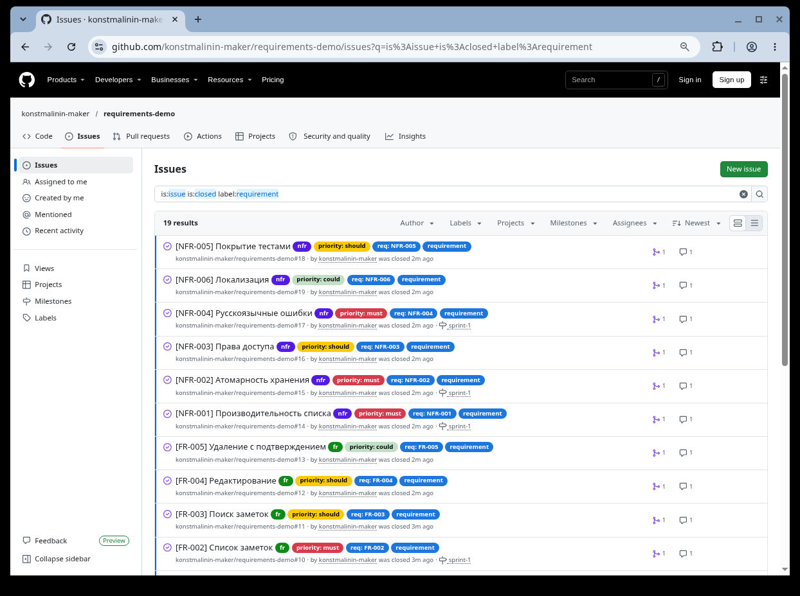

Рисунок 3. Все 19 закрытых Issues по требованиям, метки типа, приоритета и REQ-ID.

## 4. Реализация и история изменений

CLI устанавливается через `python -m pip install -e .`, затем доступна команда `note`. Для изолированного запуска используется `note --storage ./demo-notes.json ...`; файл можно выбрать и переменной `NOTES_FILE`.

- `add --title ... --body ...`: создаёт заметку с полным UUID4 и UTC-датами. Заголовок — 1–100, текст — 1–10000 символов после trim.
- `list`: выводит ID, заголовок и дату; пустое хранилище обрабатывается отдельно.
- `search --query ...`: использует trim и Unicode casefold для поиска в заголовке и тексте.
- `edit ID --title ... --body ...`: валидирует все изменения до сохранения, не меняет ID и created_at.
- `delete ID`: запрашивает подтверждение. Отказ и EOF сохраняют запись, неизвестный ID диагностируется.
- `export --format json`: использует реестр обработчиков; тестовый новый формат подключается без изменения ядра.

Атомарное сохранение: временный файл в том же каталоге → JSON → flush/fsync → os.replace → fsync каталога. Временные и итоговые файлы имеют 0600. Инъекция ошибки до replace подтвердила сохранность прежнего JSON и очистку временного файла. Гарантия не распространяется на физический отказ носителя и несогласованные параллельные писатели.

Сообщения об ошибках и справка вынесены в `src/messages_ru.json`. Ожидаемые ошибки выводятся без traceback с ненулевым кодом и подсказкой.

Работа разбита на реальные коммиты: спецификация по типам, локализация, хранилище, операции, экспорт, CLI, тесты и автоматизация. В коммитах указан соответствующий REQ-ID. Отдельное изменение поиска связано с FR-003@v2.

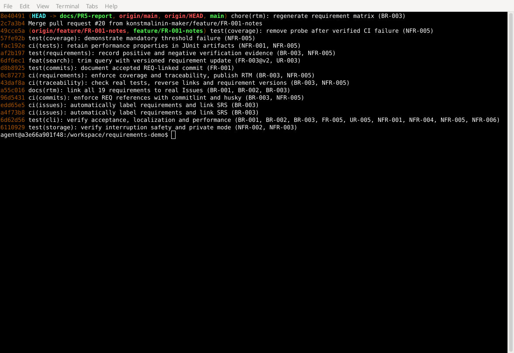

Рисунок 4. История коммитов с REQ-ID и отдельным автокоммитом RTM.

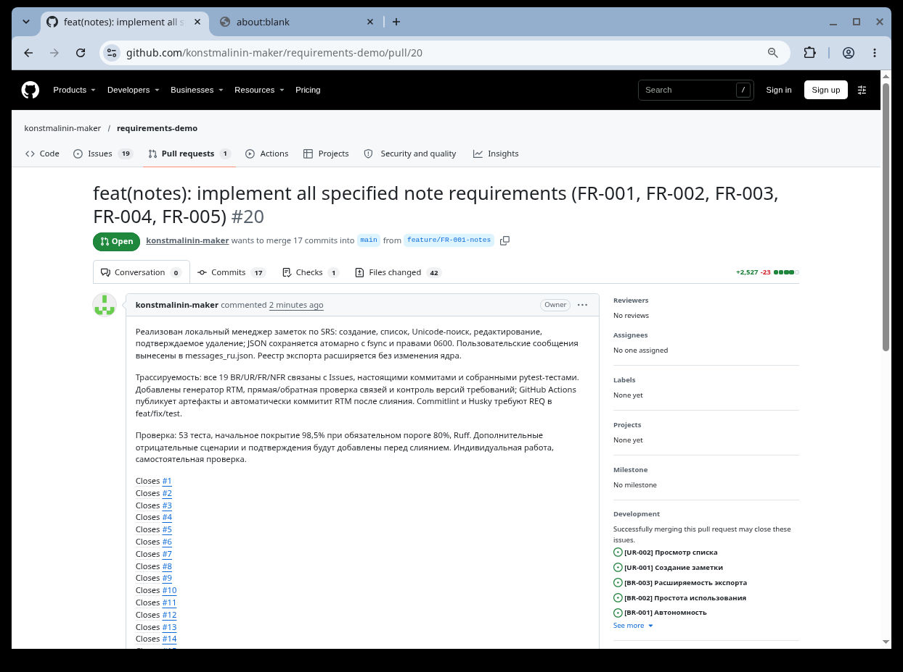

Рисунок 5. PR #20 в открытом состоянии, до слияния.

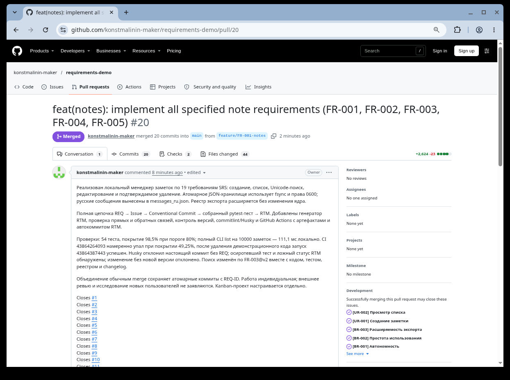

Рисунок 6. PR #20 после слияния, связанные Issues закрыты.

## 5. Матрица трассируемости и автоматизация

`generate_rtm.py` получает `git log --pretty=%H|%s|%an|%ad`, извлекает ID, группирует коммиты, добавляет ссылки на Issues и pytest node IDs. Свидетельством реализации считаются изменения кода, тестов, скриптов или настроек CI с соответствующим ID; чисто документального коммита недостаточно. Автокоммиты `chore(rtm):` исключены, чтобы избежать самоссылок и бесконечного изменения файла.

`check_traceability.py` читает определения только из заголовков SRS, а не из любых упоминаний ID. Сверяет реестр и версии, наличие Issue и коммита, тесты для FR/UR, отсутствие неизвестных ID в тестах и невозможные статусы RTM. Связи тестов извлекаются из фактически собранных pytest-тестов с `pytest.mark.req`, а не из случайных комментариев.

Итог проверки: **19 требований**, все 19 упомянуты в коммитах, **54 собранных теста**, **PASS**. Важно: наличие ссылки на тест не доказывает корректность поведения; тесты дополнительно реально запускаются в CI.

GitHub Actions запускается на push и PR в main. Выполняются Ruff, commitlint, pytest-cov с обязательным порогом, генерация RTM, проверка трассируемости и версий. Отчёт трассируемости, RTM, JSON/XML/HTML покрытия и JUnit публикуются как артефакт. После успешного push в main отдельное задание использует git-auto-commit-action для обновления RTM.

[Успешный запуск 43864521678](https://github.com/konstmalinin-maker/requirements-demo/actions/runs/43864521678) завершил оба задания: tests-and-traceability и regenerate-and-commit-rtm. Бот создал [коммит 8e40491](https://github.com/konstmalinin-maker/requirements-demo/commit/8e40491). Бейдж CI добавлен в README.

![Автоматически созданная RTM в GitHub; автор последнего изменения — github-actions[bot]](docs/pr5-images/06-generated-rtm.png)

Рисунок 7. Автоматически созданная RTM в GitHub; автор последнего изменения — github-actions[bot].

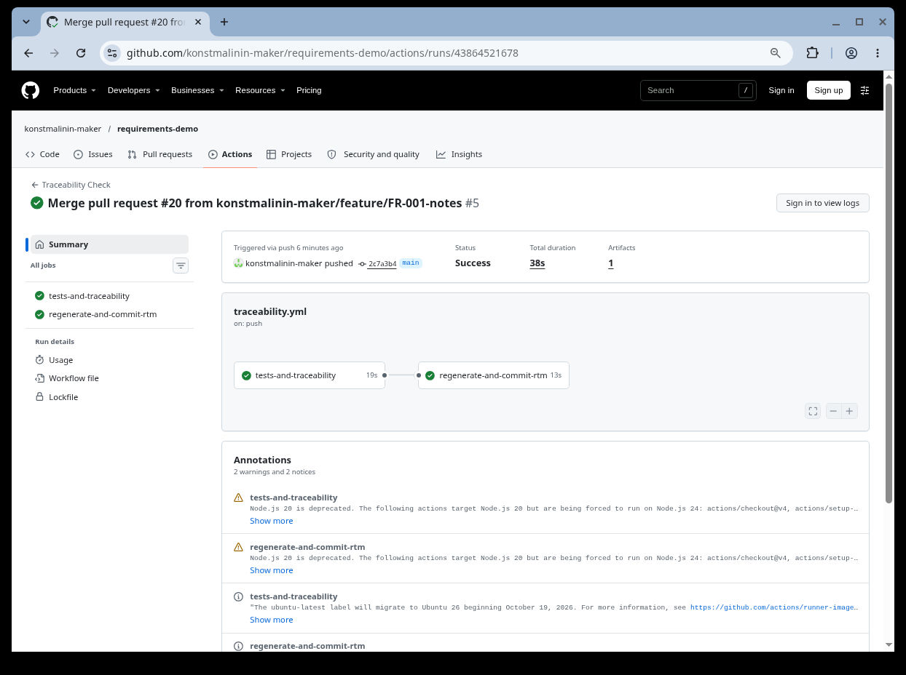

Рисунок 8. Успешный workflow: проверка, автогенерация RTM и артефакт.

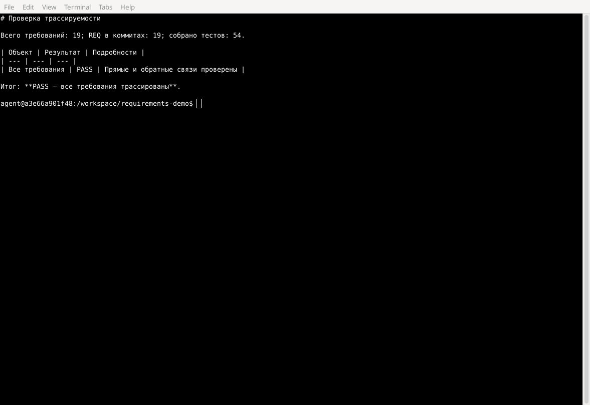

Рисунок 9. Результат реального локального запуска check_traceability.py: PASS.

## 6. Дополнительные задания A–G

### A. Автогенерация RTM — выполнено

Генератор читает историю Git, группирует связи по REQ и создаёт Markdown-таблицу. При push в main CI обновляет файл и фиксирует изменения ботом. Скриншот RTM и коммит 8e40491 приведены выше. Исходный код: `scripts/generate_rtm.py`, workflow: `.github/workflows/traceability.yml`.

### B. Порог покрытия pytest-cov — выполнено

В `pyproject.toml` задан `fail_under = 80`, в CI используется `--cov-fail-under=80`. Рабочее покрытие — 197/200 строк, то есть **98,5%**.

Для отрицательного сценария добавлен временный `src/coverage_demo.py` с 200 исполняемыми непокрытыми строками. [Запуск CI 43864264093](https://github.com/konstmalinin-maker/requirements-demo/actions/runs/43864264093) завершился ошибкой: **49,25% < 80%**, exit code 1, хотя все 54 поведенческих теста прошли. Это подтверждает работу отдельного ограничения покрытия.

После фиксации результата демонстрационный код удалён коммитом 49cce5a. [Запуск 43864387443](https://github.com/konstmalinin-maker/requirements-demo/actions/runs/43864387443) снова успешен. В main нет искусственно непокрытого файла. Сохранён настоящий журнал `docs/evidence/coverage-ci-failed.txt`.

Снимок ниже показывает локальное покрытие и измерение производительности. Предупреждение первого JUnit-экспорта касалось формата дополнительных свойств и не было ошибкой тестов; для последующего CI установлен совместимый `junit_family = xunit1`.

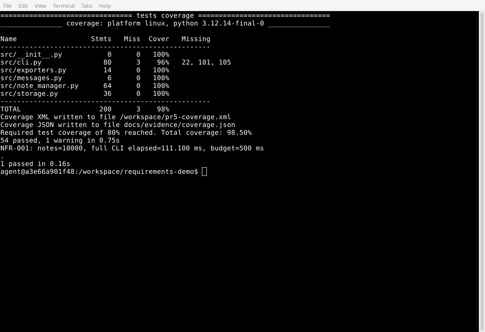

Рисунок 10. Покрытие 98,50%, 54 passed и измерение list: 111,100 мс при 10000 заметок.

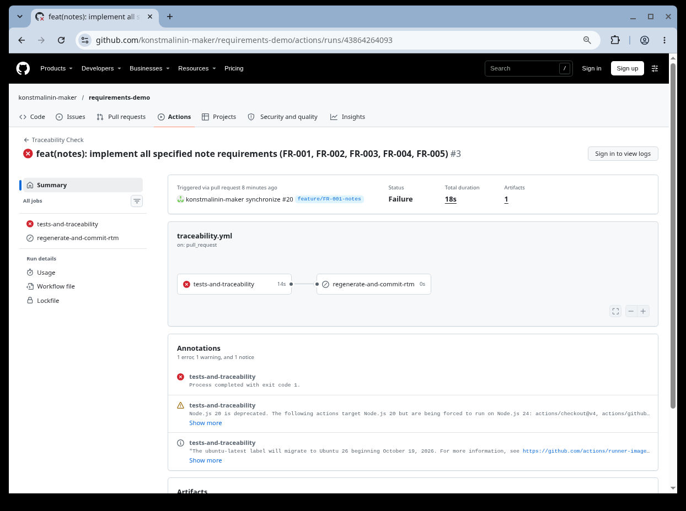

Рисунок 11. Намеренно неуспешный workflow проверки покрытия.

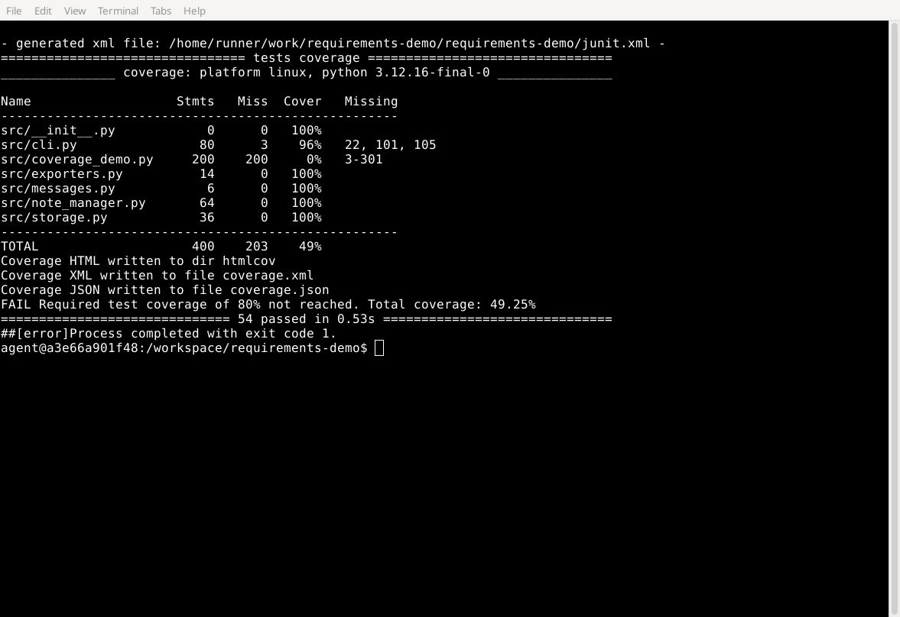

Рисунок 12. Настоящий журнал CI: порог 80% не достигнут, покрытие 49,25%, exit code 1.

### C. Commitlint и Husky — выполнено

Установлены `@commitlint/cli`, `@commitlint/config-conventional`, `husky`; зависимости зафиксированы в package-lock.json. Правило `req-reference` требует ссылку в скобках для feat/fix/test, например `(FR-001)` или `(FR-003@v2, UR-003)`. Поддерживаются все типы требований.

Проверен настоящий `git commit --allow-empty -m "feat: add something"`: hook отклонил его, exit code 1, HEAD не изменился. Затем выполнен действительный коммит с изменением файла и ссылкой `(FR-001)` — d8b8925, exit code 0. Журналы сохранены и показаны в терминале. CI дополнительно проверяет диапазон коммитов, поэтому локальный hook не является единственным контролем.

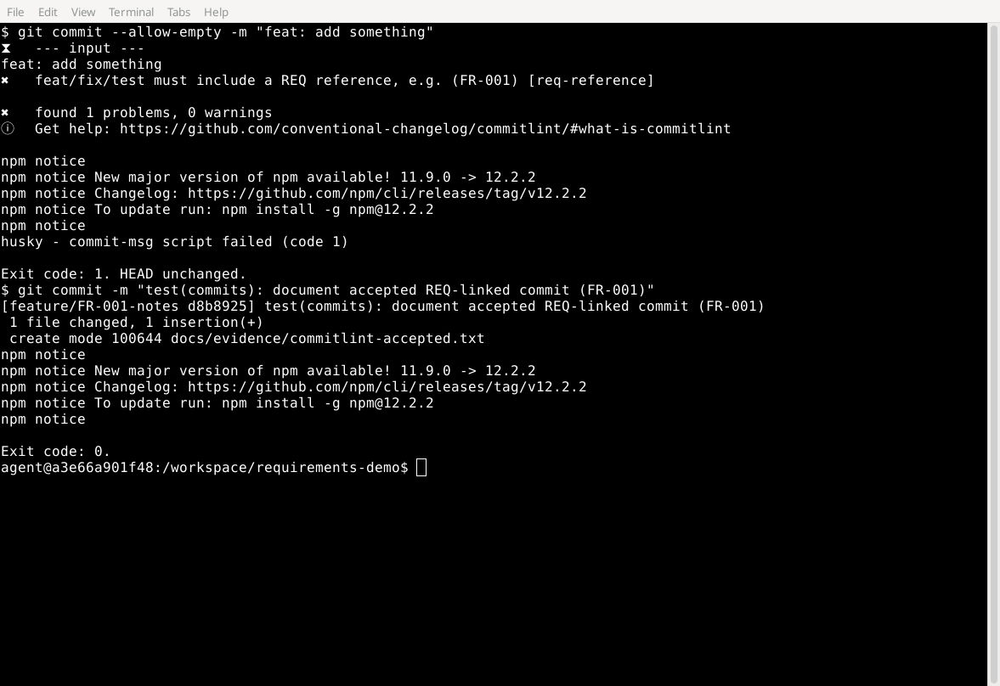

Рисунок 13. Сохранённые журналы реального отклонённого и принятого коммитов.

### D. Автоматическая метка REQ-ID — выполнено

Workflow `issue-requirements.yml` на события opened/edited разбирает `[FR-001]` в заголовке, проверяет существование определения в SRS, создаёт `req: FR-001` и публикует комментарий со ссылкой. Используется `actions/github-script@v7` и права issues:write.

Повторное редактирование обновляет существующий комментарий бота; лишние старые req-метки удаляются. Все 19 Issues размечены автоматически. На Issue #9 видны метка, комментарий github-actions и ссылка на SRS.

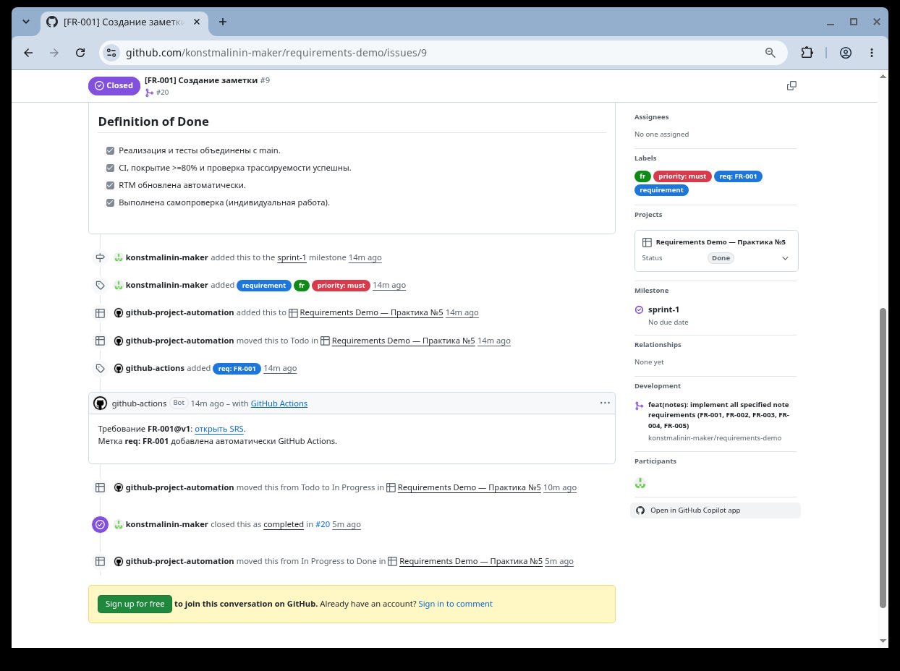

Рисунок 14. Автоматическая req-метка, комментарий со ссылкой на SRS и переход карточки в Done.

### E. GitHub Projects / Kanban — выполнено

Создан публичный [Project №2](https://github.com/users/konstmalinin-maker/projects/2). В него автоматически добавлены все 19 Issues. В истории Issue #9 подтверждены действия github-project-automation: добавление в проект, Todo → In Progress и переход в Done после закрытия через PR #20.

Настроены четыре колонки **Backlog, In Progress, Review, Done** и текстовое поле **REQ-ID**, заполненное для всех 19 карточек. Все завершённые задачи находятся в Done. Состояние проверено через GitHub API и фактическую доску. Автопереход после закрытия подтверждён историей Issue #9; эта часть задания E выполнена совместно с владельцем аккаунта, поскольку подключение не имеет прав записи в Projects.

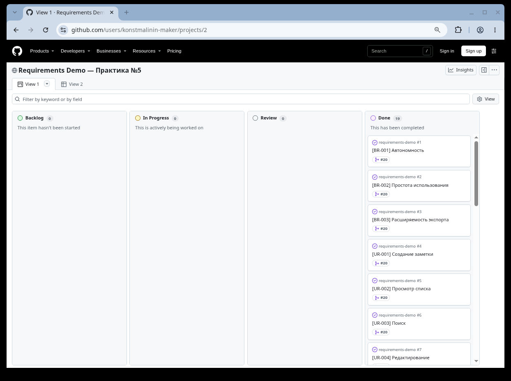

Рисунок 15. Kanban-доска GitHub Projects с требованиями.

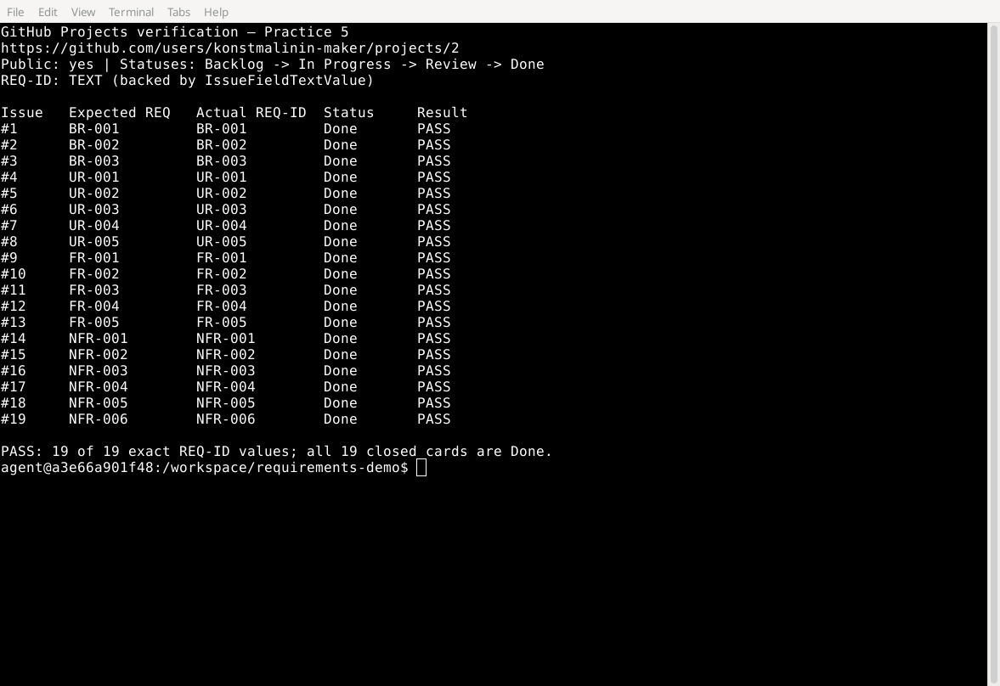

Рисунок 16. Проверка всех 19 значений REQ-ID и статусов Done по сохранённому ответу GitHub API.

### F. Обратная трассируемость — выполнено

Проверка использует реальные собранные тесты. Добавлен временный тест с `pytest.mark.req("FR-999")`, хотя этого требования нет в SRS. Скрипт вернул FAIL и указал node ID осиротевшего теста. Отдельно в RTM временно добавлена строка FR-999 со статусом «Трассировано» без коммита; она также обнаружена.

Оба демонстрационных изменения удалены, сохранены Markdown-отчёты с ошибками. Разница в числе тестов в этих журналах отражает добавление и удаление диагностического теста; позже добавлен тест FR-003@v2, итоговый набор — 54. Текущая проверка — PASS. Выходной `docs/traceability-report.md` включён в артефакт CI.

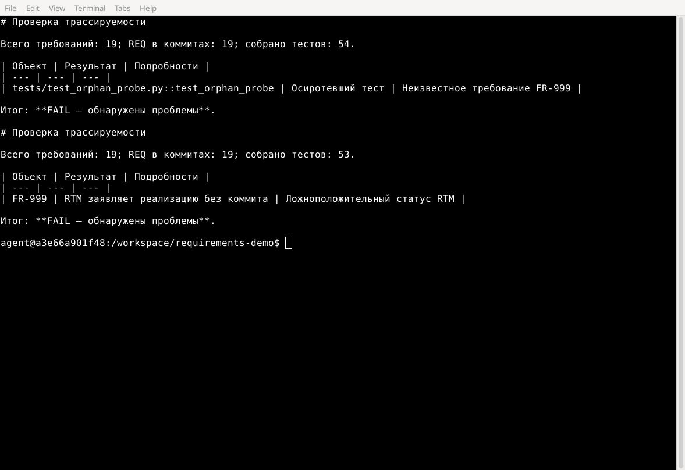

Рисунок 17. Обнаружены осиротевший тест и ложный статус реализации без коммита.

### G. Версионирование требований — выполнено

Введены заголовки ID@vN, согласованный реестр версий и changelog. Скрипт `check_requirement_versions.py` сравнивает каждый блок с базой PR, требует ровно +1 при изменении текста, запрещает удаление определения без сохранения ID, проверяет синхронность реестра и изменение changelog.

Отрицательный сценарий: в FR-001 изменён предел заголовка без изменения @v1. Проверка отклонила изменение: ожидалась v2, получена v1; затем исходный текст восстановлен.

Положительный сценарий — реальное изменение поиска FR-003: пробелы по краям запроса теперь удаляются. Требование повышено с @v1 до @v2, обновлены `registry.json`, ядро, тест и changelog. Всё объединено через PR #20. Коммит — 6df6ec1. Проверка относительно исходной main прошла; в журнале `origin/main` относится к базе до слияния PR.

При будущей отмене требования ID остаётся занятым: необходимо оставить определение со статусом retired и новую версию, а не назначать этот ID другой функции.

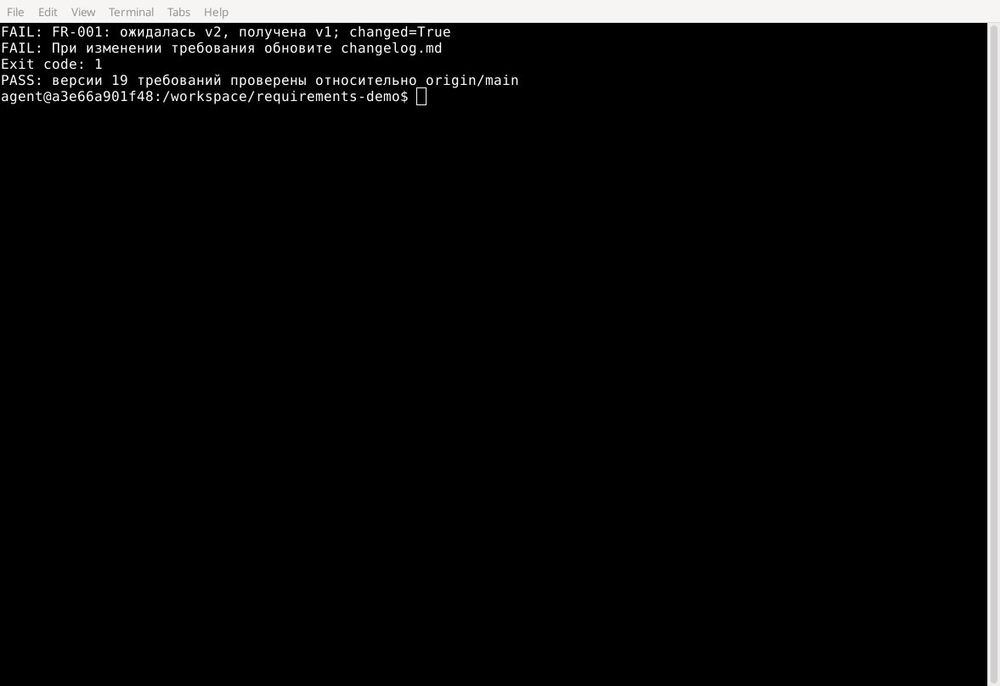

Рисунок 18. Изменение без новой версии отклонено; согласованная редакция успешно проверена.

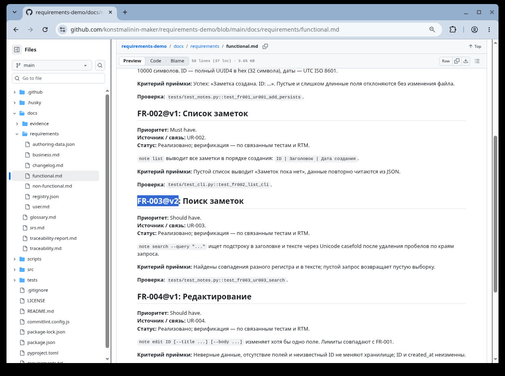

Рисунок 19. Фактическое определение FR-003@v2 с правилом удаления пробелов запроса.

## 7. Ответы на контрольные вопросы

**1. Почему SRS лучше вести прямо в репозитории?**

Требования версионируются вместе с кодом, доступны в том же PR и связаны с тестами. Проще определить, какая редакция требования действовала для конкретного коммита, и проверить согласованность изменения.

**2. Зачем уникальная нумерация и что произойдёт при переиспользовании ID?**

Постоянный ID однозначно связывает требование с историей. Если выдать старый ID другой функции, ссылки в коммитах, Issues и тестах начнут означать разные вещи. Поэтому номер не освобождается; меняется версия или статус retired.

**3. Как связать коммит с требованием?**

Использовать Conventional Commits с ID в сообщении: `feat(search): trim query (FR-003@v2, UR-003)`. Ветки и PR также содержат ссылки на требование и Issue. GitHub понимает #N, но REQ-ID требует собственной ссылки или автоматизации.

**4. Что такое RTM и какие задачи она решает?**

Это матрица связей REQ → Issue → коммит → код/тест → результат. Она помогает находить непокрытые требования, осиротевшие тесты, оценивать влияние изменений и собирать доказательства верификации.

**5. Какие ключевые слова автоматически закрывают Issues?**

`Closes`, `Fixes`, `Resolves` и поддерживаемые GitHub формы этих слов с `#N`. Закрытие происходит при попадании связанного изменения в основную ветку. `Refs #N` создаёт ссылку, но не закрывает задачу. В PR #20 каждая Issue перечислена отдельной строкой Closes.

**6. Как автоматизировать трассируемость?**

Хранить определения SRS в Markdown, собирать ID из git log и pytest-маркеров, проверять полноту скриптом, генерировать RTM и запускать проверки в GitHub Actions. Commitlint контролирует формат сообщений, pytest-cov — покрытие строк, отдельный скрипт — версии требований.

**7. Что делать при удалении требования, на которое ссылаются старые коммиты?**

Сохранить ID и историю, отметить требование как retired, объяснить причину в changelog и изменить статус связанного Issue. Старые ссылки остаются корректными; нельзя физически стирать идентификатор и переиспользовать его.

**8. Как проверить, что каждый FR имеет хотя бы один тест?**

Собрать тесты через pytest --collect-only и их `req`-маркеры, затем для каждого определённого FR проверить наличие реального node ID. После проверки связей необходимо запустить сами тесты: наличие маркера не доказывает корректность реализации.

**9. Зачем нужен глоссарий?**

Он задаёт общее значение терминов: заметка, хранилище, атомарность, версия требования и верификация. Без общего словаря одинаковые формулировки могут трактоваться разработчиком и проверяющим по-разному.

**10. В чём преимущества requirements-as-code перед отдельным документом?**

Единая история требований и реализации, ревью через PR, воспроизводимые проверки, прямые и обратные связи, меньше ручного рассогласования. При этом автоматизация не заменяет обсуждение смысла требования и внешнюю приёмку.

## 8. Трудности и решения

| Трудность | Решение |
| --- | --- |
| Подключение не позволяет создавать репозитории и настраивать Projects | Пустой репозиторий и проект созданы владельцем; остальные операции выполнены в пределах доступных прав; ограничение записи Projects зафиксировано |
| Простое сканирование текста считало бы упоминание ID тестом | Используется реальная коллекция pytest с node IDs и маркерами |
| Документальный коммит мог бы ошибочно считаться реализацией | Для статуса реализации нужны реальные изменения исходников, тестов, скриптов или CI с этим ID |
| Автокоммит RTM создаёт новую запись в истории | Автокоммиты исключены из собственных связей, используется отдельное задание после успешной проверки |
| Покрытие высокое, но порог мог не действовать | В CI воспроизведено падение 49,25% и последующее восстановление |
| Изменение поиска могло рассогласовать SRS и код | Одновременно обновлены FR-003@v2, код, тест, реестр и changelog |
| UUID в примере PDF был коротким | Использован полный UUID4; решение отражено в SRS и changelog |
| Удобство для нового пользователя нельзя доказать одним автотестом | Результат ограничен индивидуальным сценарием и проверкой справки; независимое исследование не заявлено |

## 9. Итог и материалы проверки

**Все семь дополнительных заданий A–G выполнены.** Настройки Projects выполнены владельцем аккаунта и проверены по сохранённому ответу API; снимок доски и проверка всех 19 REQ-ID добавлены в отчёт.

Созданы публичный репозиторий, модульная SRS с 19 требованиями, 19 связанных Issues, Conventional Commits, рабочий CLI, тесты, RTM и CI. PR #20 объединён обычным merge с сохранением истории и закрыл все Issues. Прямая и обратная трассируемость проходят. Порог покрытия и контроль сообщений/версий подтверждены положительными и отрицательными сценариями.

В отчёте приведены реальные скриншоты GitHub и терминала. Локальные снимки журналов отображают сохранённый фактический вывод проверок, а не заново нарисованные результаты. Состояния до и после изменений объяснены в соответствующих разделах.

Проверочные материалы: [docs/evidence](https://github.com/konstmalinin-maker/requirements-demo/tree/main/docs/evidence), [RTM](https://github.com/konstmalinin-maker/requirements-demo/blob/main/docs/traceability.md), [отчёт трассируемости](https://github.com/konstmalinin-maker/requirements-demo/blob/main/docs/traceability-report.md).
